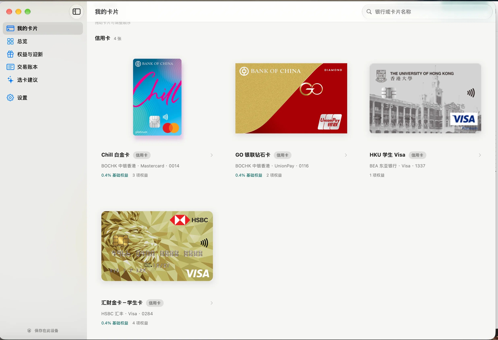
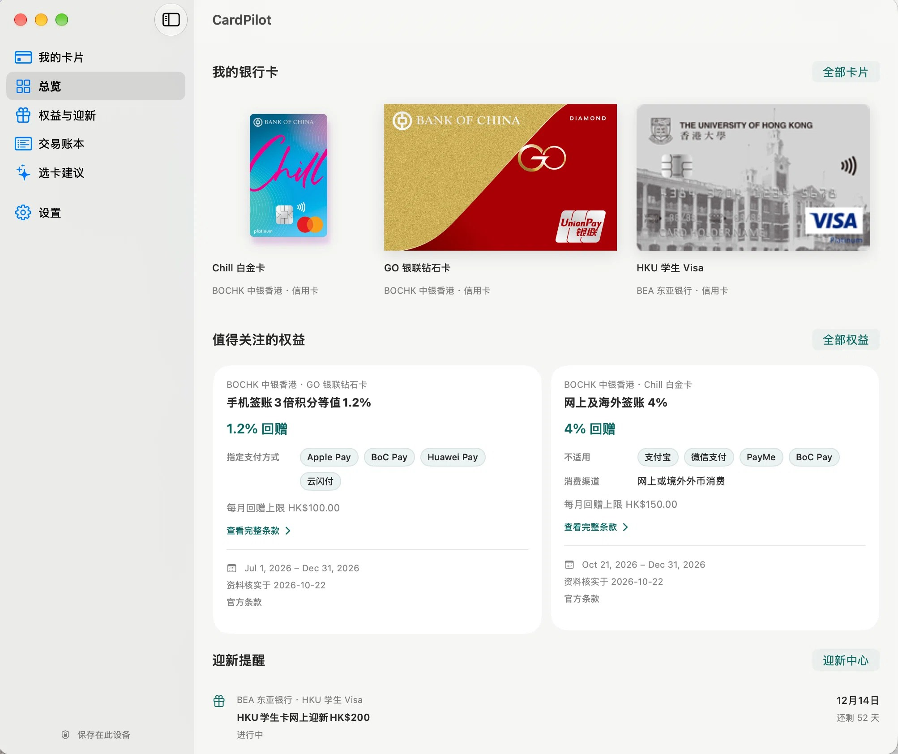
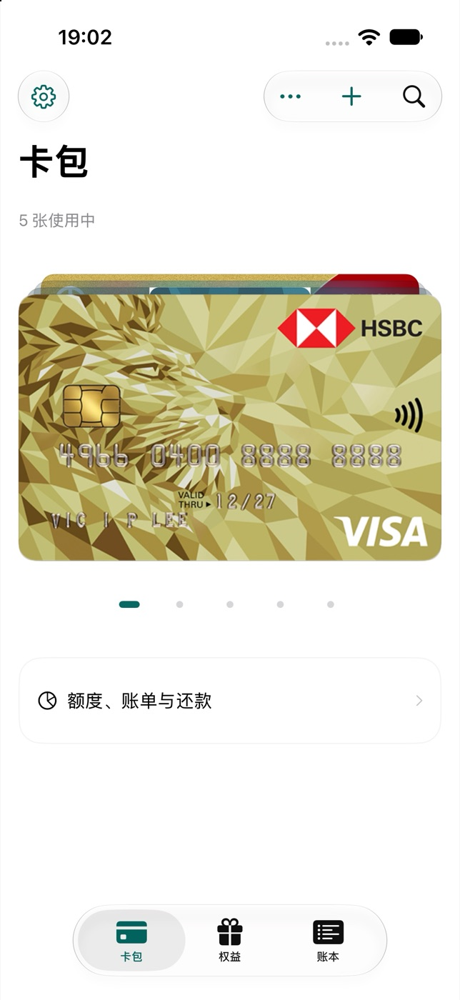
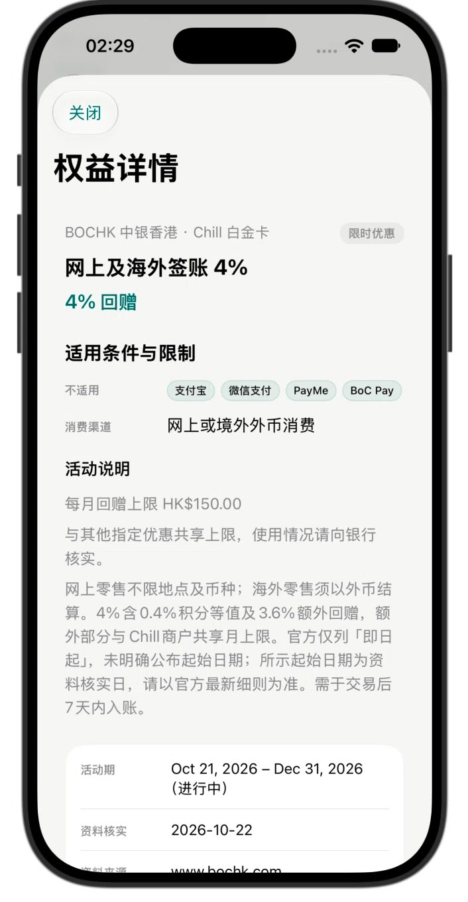
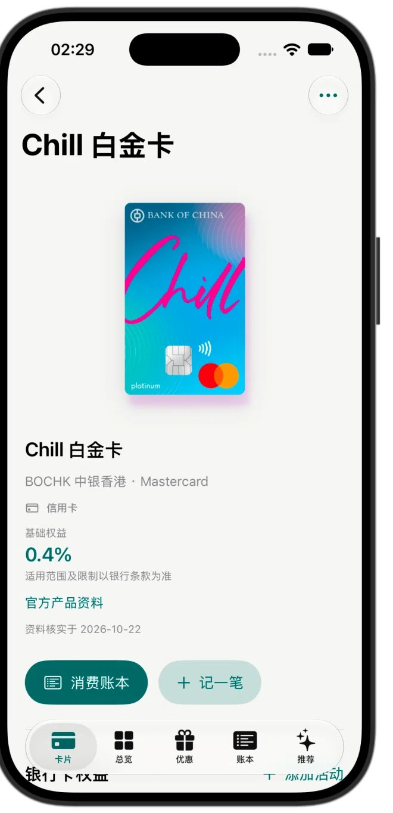

<div align="center">


# CardPilot

**把银行卡权益、迎新进度和日常消费，放回你自己的设备。**

一款为香港银行卡设计的原生 Apple App。SwiftUI + SwiftData，离线优先，不要求账号，也不会上传你的账本。

[](#系统要求)
[](#技术栈)
[](#技术栈)
[](#技术栈)
[](LICENSE)

[功能](#功能) · [截图](#界面) · [开始使用](#开始使用) · [架构](#架构) · [参与贡献](CONTRIBUTING.md)

</div>



## 为什么是 CardPilot

银行 App 擅长告诉你“刷了多少钱”，却很少帮你回答另外几个问题：

- 这张卡现在到底有哪些权益？条件是怎样的？
- 迎新活动走到哪一步了？奖励到账了吗？
- 这笔消费该用哪张卡？有哪些已知限制？
- 这些资料是官方的，还是我自己改过的？

CardPilot 把这些问题放回一个安静、离线优先的本地工作区：官方资料只读更新，个人状态独立保存，消费记录留在自己的设备或自己的同步文件夹里。

## 功能

| | |
| --- | --- |
| **权益清楚可查**<br>按日常、限时、指定商户和迎新分类浏览。展示适用条件、日期、来源、核实时间与官方条款入口。 | **迎新自己掌握**<br>记录申请、发卡、个人截止日、奖励和到账状态。到期提醒只看你确认过的日期。 |
| **消费轻量记录**<br>手动、CSV、短信粘贴、银行邮件或 Apple Pay 快捷指令入账。保留原币和未知字段，不强行补成事实。 | **选卡建议克制**<br>按类别、地区、金额和支付方式展示可能适用的权益与限制，不模拟银行结算，也不承诺精确回赠。 |
| **官方资料只读更新**<br>启动或回到前台时检查公开资料快照，成功后每 6 小时最多一次；失败后 5 分钟重试。网络失败时继续使用最后有效缓存或内置资料。 | **跨设备同步**<br>用自己选择的 iCloud Drive 或共享文件夹同步，无需 CloudKit、服务器或 CardPilot 账号。 |
| **信用卡 / 扣账卡**<br>卡片按类型标记和筛选；可以选择一起显示，也可以按类型分组。 | **本地优先**<br>没有分析 SDK、没有广告、没有远端账本。个人尾号、备注和消费不会进入公开资料库。 |

## 界面

### macOS

<p align="center">
  
  
</p>

### iPhone

<p align="center">
  
  
  
</p>

## 资料库与官方卡面

资料库使用公开的 **Catalog Schema V2**：银行、产品、官方卡面、Logo、来源与活动都由云端快照定义。当前提供 **5 家银行、15 款产品**：

- **HSBC 汇丰**：学生 Visa 金卡、Pulse 银联双币钻石卡、Mastercard 扣账卡
- **BOCHK 中银香港**：Chill 白金卡、GO 银联钻石卡、GO 白金卡、大湾区青年卡、万事达扣账卡
- **BEA 东亚银行**：HKU 学生 Visa、UDC 钻石卡、UDC 钻石学生卡
- **CNCBI 信银国际**：GBA 双币卡、多币扣账卡
- **BOCOM 交通银行（香港）**：Go-Goal Visa 白金卡、大湾区银联双币钻石卡

资料由 [CardPilot-Catalog](https://github.com/YangChen-cn/CardPilot-Catalog) 以只读快照发布，新增银行或产品只需更新资料库，不需要发布新版 App。官方卡面按 SHA-256 独立下载并缓存，单张图片失败不会影响权益资料；个人卡片、尾号、备注、迎新和消费始终单独保存在本机。网络不可用时，最后一份有效快照或精简的内置资料继续工作，首次启动也不需要等待网络。

> 资料用于整理和比较，不构成银行官方说明或财务建议。权益、费率和活动以银行最新条款为准。

## 隐私与数据

- **不要求注册**：没有 CardPilot 账号，没有远端用户数据库。
- **不上传账本**：卡片、消费、备注、迎新记录只写入本机 SwiftData。
- **不上传个人资料到公开仓库**：官方资料库只包含产品、通用权益、卡面和来源链接。
- **邮件记账是可选的**：需要自己部署 Google Apps Script，并把连接密钥保存在本机钥匙串。详见[银行邮件记账](docs/bank-email-cloud.md)。
- **可随时导出/迁移**：数据保存在本地，也可以通过自己的同步文件夹带走。

发现安全问题请不要公开敏感细节，按 [SECURITY.md](SECURITY.md) 的方式报告。

## 系统要求

- macOS 26 或更新版本
- iOS / iPadOS 26 或更新版本
- Xcode 26 或更新版本（当前开发使用 Xcode 27）
- [XcodeGen](https://github.com/yonaskolb/XcodeGen)（修改 `project.yml` 或增删源文件后需要）

## 开始使用

```sh
git clone https://github.com/YangChen-cn/CardPilot.git
cd CardPilot
xcodegen generate
open CardPilot.xcodeproj
```

在 Xcode 中选择 `CardPilotMac` 或 `CardPilotIOS` scheme 运行。

### 命令行构建

macOS：

```sh
xcodebuild \
  -project CardPilot.xcodeproj \
  -scheme CardPilotMac \
  -configuration Debug \
  -derivedDataPath build/PublicDerivedData \
  CODE_SIGN_IDENTITY="-" \
  CODE_SIGNING_REQUIRED=NO \
  build
```

iOS Simulator：

```sh
xcodebuild \
  -project CardPilot.xcodeproj \
  -scheme CardPilotIOS \
  -destination 'generic/platform=iOS Simulator' \
  -derivedDataPath build/PublicDerivedData \
  CODE_SIGNING_ALLOWED=NO \
  build
```

### 关于签名

仓库中的 `project.yml` 默认使用维护者的本机证书 `CardPilot`，因为 macOS 的可选邮件钥匙串组件依赖稳定签名身份。**普通贡献者不需要这个证书**：在 Xcode 里选择自己的 Team，或使用上面的 `CODE_SIGN_IDENTITY="-"` 构建即可。

如果不需要银行邮件记账，使用临时签名不影响权益、卡片、账本和文件夹同步；构建会跳过可选的钥匙串组件，邮件同步不可用。需要邮件记账时，请使用自己的稳定签名身份，并阅读[银行邮件记账](docs/bank-email-cloud.md)中的钥匙串说明。

### 测试

```sh
./script/test.sh -quiet
```

测试脚本默认寻找本机 `CardPilot` 证书；没有该证书时，可以在 Xcode 中运行 `CardPilotTests`，或按上面的方式覆盖签名设置。测试使用独立的 DerivedData，不会覆盖正在使用的 App 账本。

### 发布打包

开发脚本只负责 Debug 运行。发布构建使用独立脚本和 DerivedData，不会关闭或覆盖正在运行的开发版：

```sh
./script/package_release.sh all
```

默认从 `project.yml` 读取版本号和 Build 号，输出到 `build/releases/<version>/`：

- macOS：`CardPilot-<version>.dmg`（已用本机 `CardPilot` 证书签名，未公证）
- iOS：`CardPilot-<version>.ipa`（默认不签名，供使用者用自己的证书/描述文件重签；也可设置 `IOS_SIGN_IDENTITY` 使用本机证书）
- `INSTALL.txt` 和每个产物的 `.sha256`

只打一个平台可传 `mac` 或 `ios`；版本可用 `--version`/`--build` 覆盖。iOS 产物不是 App Store/TestFlight 安装包，最低 iOS 26.0。

## 技术栈

- **SwiftUI**：macOS / iPhone / iPad 共用数据与业务层，按宽度调整布局。
- **SwiftData**：卡片、消费、活动和同步文档的本地存储；V3 schema，含旧数据兼容路径。
- **Observation**：资料库、同步和界面状态的轻量响应式更新。
- **文件同步**：`NSFileCoordinator` + 每台设备独立快照，支持用户自选文件夹或 iCloud Drive。
- **只读资料库 V2**：云端定义银行、产品和卡面；原子快照 + ETag/Last-Modified + SHA-256 图片缓存；失败不覆盖最后有效版本。

```text
App/
  Features/      卡片、总览、权益、账本、推荐、设置
  Models/        SwiftData 模型
  Services/      资料库、权益投影、同步、定价、邮件导入
  Resources/     内置 Catalog 回退、图标、快捷指令
Tests/           Swift Testing 单元与回归测试
docs/            架构、资料库、同步、邮件和技术说明
cloud/           可选的 Google Apps Script 邮件采集端
script/          构建、测试、资料生成与辅助脚本
```

## 文档

- [权益优先架构](docs/product-architecture.md)
- [银行卡资料库维护](docs/bank-library-development.md)
- [文件夹同步](docs/folder-sync.md)
- [银行邮件记账](docs/bank-email-cloud.md)
- [消费与账户](docs/transactions-and-accounts.md)
- [HSBC 资料研究](docs/hsbc-library-research.md)
- [BOCHK / BEA 资料研究](docs/bochk-bea-library-research.md)
- [CNCBI 信银国际资料研究](docs/cncbi-library-research.md)

## 参与贡献

欢迎提交 issue、资料修正和 Pull Request。开始前请阅读 [CONTRIBUTING.md](CONTRIBUTING.md)。

- 不要提交真实卡号、尾号、交易、邮件、连接密钥或个人信息。
- 新增/修改银行资料时，请附官方来源、核实日期和卡面来源。
- UI 改动请附截图或录屏；资料修正请附条款或官方页面链接。
- 提交前至少运行受影响的测试或说明未运行的原因。

## 许可证

本项目以 [MIT License](LICENSE) 开源。

CardPilot 与各银行无隶属关系。银行名称、商标、卡面和产品资料归各自权利人所有，仅用于识别和说明。银行权益与费率可能随时变化，请以银行官方条款为准。
